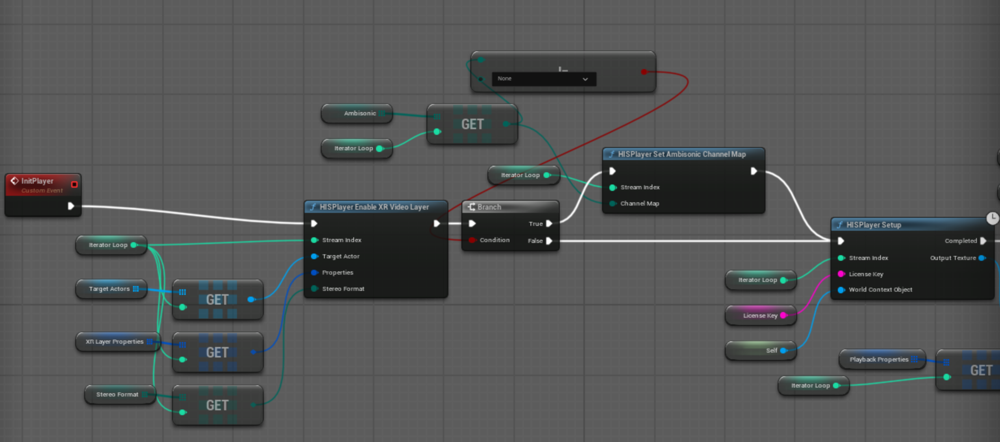
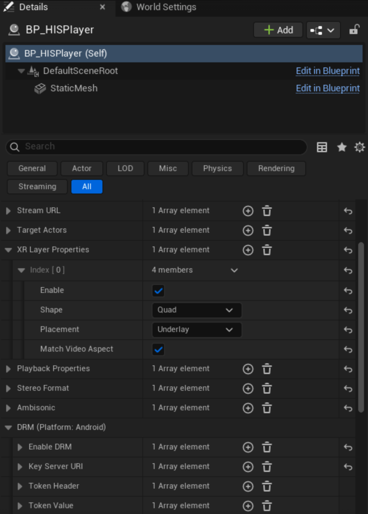
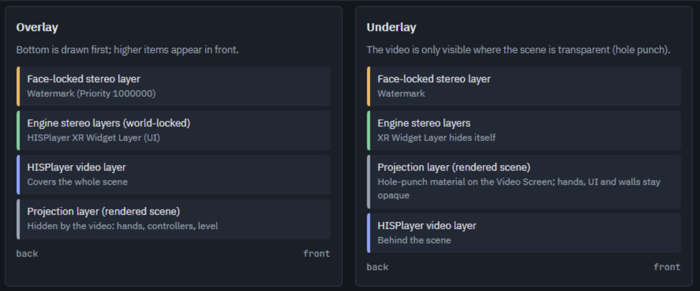

# XR Video Layer
Use XR Video Layer to play Widevine L1 DRM content and high resolution video.

Call `HISPlayer Enable XR Video Layer` with Target Actor, XR Layer Properties and Stereo Format parameters.
Call it after `BeginPlay` and before `Setup` of the same stream to use XR Video Layer. 
<p align="center">

</p>
If it is not called or XRLayerProperties.Enable is false, then Texture Render mode will be used. In this case only DRM L3 is available.

## XR Video Layer Properties
With this user can specify the properties of XR Video Layer.
<p align="center">

</p>

  * **Enable**: Whether this instance outputs through an XR Video layer. When off, the texture path is used.
  * **Shape**: The shape of output video. Quad, Equirect 360, Equirect 180
  * **Placement**: The order of XR Video Layer. Overlay or Underlay.  
  * **bMatchVideoAspect**: Quad only. Shrinks the quad inside the screen area to the aspect ratio of one eye of the video.

## XR Video Layer Placement

The compositor blends submitted layers in array order, back to front. The engine's projection layer (the rendered scene) sits at index 0. Video layers are inserted as follows:

* **Overlay**: Right after the projection layer (from index 1), before the engine's stereo layers, so stereo layers draw over the video.

* **Underlay**: Before the projection layer (from index 0).

When sorting stereo layers, UE OpenXRHMD always puts face-locked layers last, then orders by Priority.

<p align="center">

</p>

### Comparison and how to choose
| Aspect | Overlay | Underlay (default) |
| --- | --- | --- |
| Hands, controllers, ray | Hidden by the video | Drawn over the video |
| Scene UI (World Widget) | Needs XR Widget Layer always over the video, even over hands | Shown as is correct depth order with hands |
| Project settings | None | `r.Mobile.PropagateAlpha` and `xr.OpenXRInvertAlpha` |
| Level setup | The Quad screen mesh is hidden automatically | The Video Screen mesh becomes the hole punch (Quad plane, Equirect sphere) |
| Best for | Immersive video-only playback, simple or empty scenes | Showing video together with hands, UI and surroundings


### Using Overlay
* In BP_HISPlayer's XRLayer Properties, set Enable = on and Placement = Overlay.

* **Quad**: set VideoScreen to a Plane actor. 

* **Equirect**: VideoScreen is ignored. The video center faces world +X.

* **To show UI over the video**, use the `HISPlayer XR Widget Layer` component:

  * Attach it as a child of the UI actor's World space Widget Component.

  * It follows the widget's render target, draw size, pivot and visibility every frame, so its transform, texture and quad size need no setup.

  * Widget interaction keeps working through the original Widget Component.

  * It is shown only while a visible Overlay exists (IsSceneHiddenByVideoLayer()); otherwise the widget in the scene is visible.

* Hands and controllers are hidden by the video. This is inherent to Overlay; use Underlay when they must stay visible.

### Using Underlay
#### Project settings (Config/DefaultEngine.ini)

```
[/Script/Engine.RendererSettings]
r.Mobile.PropagateAlpha=True

[SystemSettings]
; HISPlayer XR video layer underlay: opaque scene pixels (alpha 0 in the engine) must be read as opaque by the compositor
xr.OpenXRInvertAlpha=1
```
* **r.Mobile.PropagateAlpha**: Carries the scene alpha into the projection layer. Without it the scene fully hides the video.

* **xr.OpenXRInvertAlpha**: UE writes alpha 0 for opaque pixels. Left as is, the compositor reads them as transparent and the whole scene looks semi-transparent.

#### Hole punch

The video is visible only where the scene is transparent, so the scene pixels over the video area must be made transparent. The SDK replaces every material slot of the Video Screen mesh with M_HISPlayerXRHolePunch.

* **Material**: /HISPlayer/HISPlayer/MaterialResources/M_HISPlayerXRHolePunch

* **Settings**: Blend Mode = Alpha Holdout, Shading Model = Unlit, one-sided, Opacity = 1, Translucency Pass = Before DOF

* **Cooking**: Loaded only at runtime with LoadObject, so nothing references it. The plugin's Config/Game.ini adds it with +DirectoriesToAlwaysCook. A plugin config is merged only when named Game.ini, not DefaultGame.ini.

* **Re-applying**: BP_HISPlayer assigns M_HISPlayerMat again after Setup, so the SDK checks every frame and re-applies the hole punch. It remembers the last material the game assigned and restores it on close.

##### Quad Underlay
* Set VideoScreen to a Plane actor; the plane becomes the hole the video is seen through.

* Hands, UI and the ray in front of the plane are drawn opaque over the video, and the surrounding walls and sky remain visible.

##### Equirect Underlay
* Set VideoScreen to an inward-facing sphere mesh around the viewer: SM_HISPlayer_Sphere for 360, SM_HISPlayer_180Sphere for 180, with a negative X scale so it faces inwards.

* **Shape and mesh must match**. Equirect 360 with the hemisphere mesh shows video only on the hemisphere, which is expected.

* Objects closer than the sphere radius (e.g. nearby walls) still hide the video.

* Without a Video Screen, hide the skybox and background meshes yourself.

With an Underlay the XR Widget Layer hides itself, so the widget rendered in the scene is visible with the correct depth order relative to hands.
